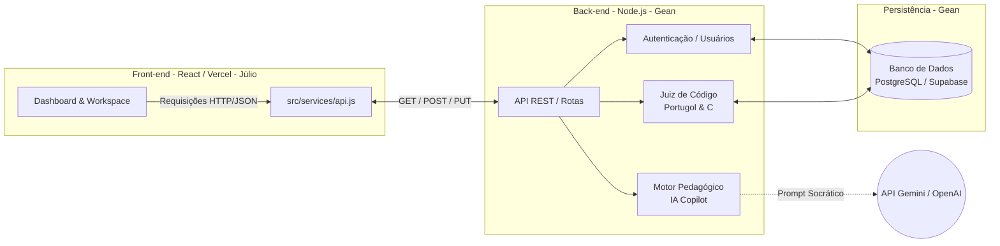
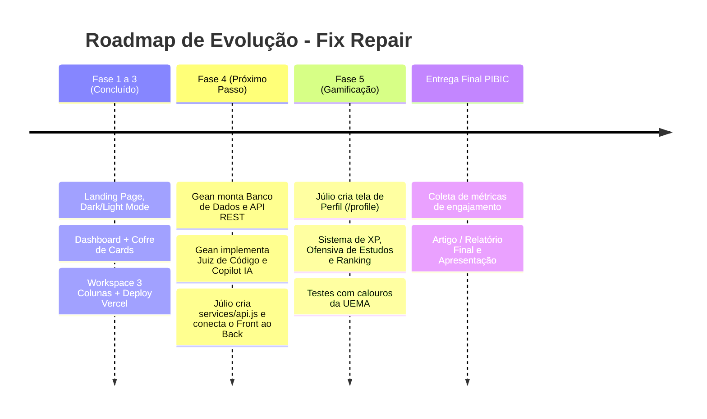

# 🛠️ Fix Repair — Guia de Arquitetura, Integração e Fluxo Git

Este documento detalha o que já foi construído no **Front-end**, define exatamente **onde o Back-end e a Inteligência Artificial (Gean)** se conectam ao sistema, estabelece o contrato de API, o plano futuro do PIBIC e as regras de versionamento no GitHub para trabalharmos em paralelo sem conflitos.

---

## 1. Visão Geral e Divisão de Responsabilidades

A plataforma **Fix Repair** foi arquitetada de forma desacoplada (*Monorepo* com duas pastas independentes na raiz) para que o Front-end (hospedado na Vercel) e o Back-end evoluam sem que um quebre o código do outro.

| Frente | Responsável | Tecnologias Principais | Escopo |
| :--- | :--- | :--- | :--- |
| **Front-end & UI/UX** | **Júlio** | React, Vite, Tailwind CSS, Lucide Icons, Vercel | Interface, rotas, responsividade, Dark/Light Mode, Dashboard, Editor visual, consumo da API. |
| **Back-end & IA** | **Gean** | Node.js (Express/Fastify), Banco de Dados, API de IA | Banco de dados, autenticação, rotas REST, Juiz de Código (Portugol/C) e Copilot Pedagógico (IA). |

---

## 2. O que já foi construído (Mapa do Front-end)

Toda a interface funcional (Fases 1 a 3) já está pronta e estruturada dentro da pasta `/frontend`. Atualmente, ela opera com dados simulados (*mocks*) para validação visual.

```text
fix-repair/
├── frontend/                  <-- [ÁREA DO JÚLIO - JÁ EM PRODUÇÃO NA VERCEL]
│   └── src/
│       ├── App.jsx            # Gerenciador de rotas (/, /dashboard, /workspace/:trackId/:lessonId)
│       ├── Workspace.jsx      # Tela de Estudos (3 colunas: Trilha, Editor/Quiz, Copilot IA)
│       ├── context/           # ThemeContext (Controle global de Dark/Light Mode)
│       ├── data/              # Dados simulados (mockTracks.js e mockSavedCards.js)
│       ├── services/          # [PONTO DE CONEXÃO] Onde ficará o api.js para chamar o Back-end
│       ├── components/
│       │   ├── layout/        # Navbar, Footer, SidebarTracks, AICopilotDrawer
│       │   └── activities/    # CodeEditorBox, MultipleChoice, AnswerFeedback, SavedCardItem
│       └── pages/
│           ├── LandingPage/   # Porta de entrada e apresentação das trilhas
│           ├── Dashboard/     # Progresso, Switch (Modo Guiado vs Livre) e Cofre de Cards
│           └── Profile/       # Reservado para a Fase 5 (Gamificação, XP e Ranking)
│
└── backend/                   <-- [ÁREA DO GEAN - CRIAR NA RAIZ DO PROJETO]
```

### Telas já implementadas:
1. **Landing Page (`/`):** Apresentação da plataforma, suporte a tema claro/escuro e visualização das trilhas de Portugol e C.
2. **Dashboard (`/dashboard`):** Barra de progresso, seletor de **Progressão Guiada vs. Modo Livre** e o **Cofre de Cards Rápidos** (revisão espaçada).
3. **Workspace de Estudos (`/workspace/:trackId/:lessonId`):** Layout em 3 colunas simultâneas:
   - *Esquerda:* Lista de módulos da trilha com status (concluído, disponível, bloqueado).
   - *Centro:* Alternância entre Múltipla Escolha e Editor de Código escuro com numeração de linhas, botão "Executar & Verificar" e console de saída.
   - *Direita:* Gaveta do **Copilot IA** com botão de ligar/desligar, atalhos pedagógicos ("Dica de Lógica", "Sintaxe") e chat.

---

## 3. Arquitetura do Sistema e Fluxo de Dados

O diagrama abaixo mostra como o Front-end (Júlio) vai conversar com o Back-end (Gean):



---

## 4. Onde o Gean entra (Pontos Exatos de Integração)

Para dar vida real à plataforma, o Gean deve criar a pasta **`backend/`** na raiz do repositório e expor uma API REST. Assim que as rotas estiverem prontas, o Júlio cria o arquivo `frontend/src/services/api.js` e substitui os dados simulados pelas chamadas reais.

### Contrato de API Sugerido (O que o Front-end espera receber)

| Funcionalidade no Site | Onde está hoje no Front | Rota sugerida no Back-end | O que o Back-end deve fazer |
| :--- | :--- | :--- | :--- |
| **Carregar Trilhas e Aulas** | `mockTracks.js` e `internalTracks` em `Workspace.jsx` | `GET /api/tracks` | Retornar a lista de trilhas, aulas e o status (`completed`, `available`, `locked`) do aluno logado. |
| **Cofre de Cards Rápidos** | `mockSavedCards.js` no `Dashboard` | `GET /api/cards` e `POST /api/cards` | Listar os cards desbloqueados pelo aluno e salvar um novo card quando ele acertar uma atividade. |
| **Executar & Verificar Código** | Função `handleRunCode` em `Workspace.jsx` | `POST /api/code/run` | Receber `{ lang, code, lessonId }`, rodar/validar a lógica em Portugol ou C e devolver `{ valid: boolean, output: string, feedback: string }`. |
| **Chat do Copilot IA** | Função `handleSendChat` em `Workspace.jsx` | `POST /api/ai/chat` | Receber `{ message, code, lang, lessonTitle }`, enviar para a IA com *prompt* de tutor (sem dar a resposta pronta) e devolver `{ reply: string }`. |
| **Atalhos da IA (Dica/Sintaxe)** | Botões de atalho no `Workspace.jsx` | `POST /api/ai/hint` | Receber `{ type: 'logic' \| 'syntax', code, lang }` e retornar uma dica curta direcionada. |

---

## 5. Manual de Sobrevivência no Git (Como Commitar Sem Quebrar o Projeto)

> **ATENÇÃO:** O Front-end já está conectado à **Vercel**, que roda em **Linux** (sensível a letras maiúsculas/minúsculas). Qualquer alteração acidental na pasta `frontend/` pode derrubar o deploy online.

### Regras de Ouro para o Gean:
1. **Isolamento de Pasta:** Trabalhe **exclusivamente** dentro da pasta `backend/` na raiz do projeto. Não altere arquivos dentro de `frontend/` sem alinharmos antes.
2. **Nunca commite arquivos pesados ou senhas:** Crie um arquivo `backend/.gitignore` contendo obrigatoriamente `node_modules/` e `.env`.
3. **Nunca trabalhe direto na `main`:** Crie sempre uma *branch* para o Back-end.
4. **Cuidado com Maiúsculas/Minúsculas:** Nunca renomeie arquivos mudando apenas de minúscula para maiúscula no Windows (o Git ignora e quebra no Linux).

### Fluxo Passo a Passo no Terminal:

**1. Antes de começar a programar no dia (Sempre atualize seu PC):**
```bash
git checkout main
git pull origin main
```

**2. Crie ou entre na sua branch de trabalho do Back-end:**
```bash
# Na primeira vez (para criar a branch):
git checkout -b feat/backend-setup

# Nos dias seguintes (para voltar para ela):
git checkout feat/backend-setup
```

**3. Na hora de salvar e enviar seu código (Commitando apenas a pasta backend):**
```bash
# Adiciona APENAS o que você fez na pasta backend
git add backend/

# Cria o commit com mensagem clara
git commit -m "feat(backend): cria rota de validacao de codigo e conexao com banco"

# Envia a sua branch para o GitHub
git push origin feat/backend-setup
```

**4. Como juntar tudo na `main`:**
No site do GitHub, abra um **Pull Request (PR)** da sua branch (`feat/backend-setup`) para a `main`. Nós revisamos juntos e clicamos em *Merge*. Assim a Vercel nunca quebra!

---

## 6. Plano Futuro e Direcionamento (Roadmap PIBIC)



### Próximas Ações Imediatas:
- **Júlio:** Finalizar estabilidade do deploy na Vercel, tirar prints para o orientador e iniciar o layout da **Fase 5 (Tela de Perfil e Gamificação)**.
- **Gean:** Clonar o repositório, criar a branch `feat/backend-setup`, iniciar o projeto Node.js dentro de `backend/` e subir a primeira rota de teste (`/api/health`) e o esboço do banco de dados.